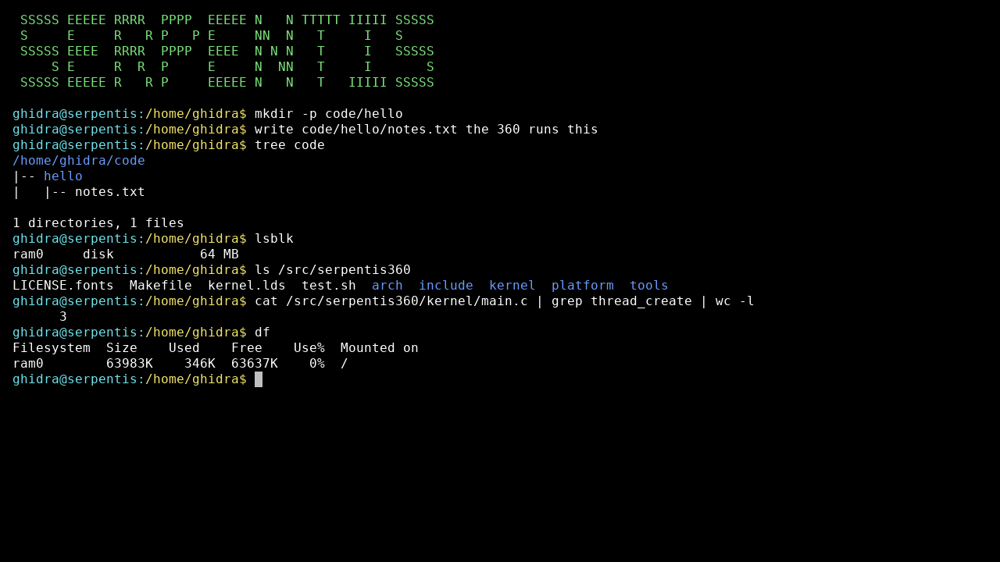
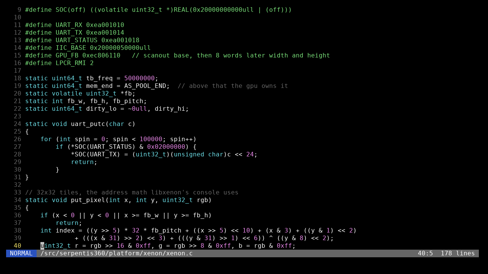
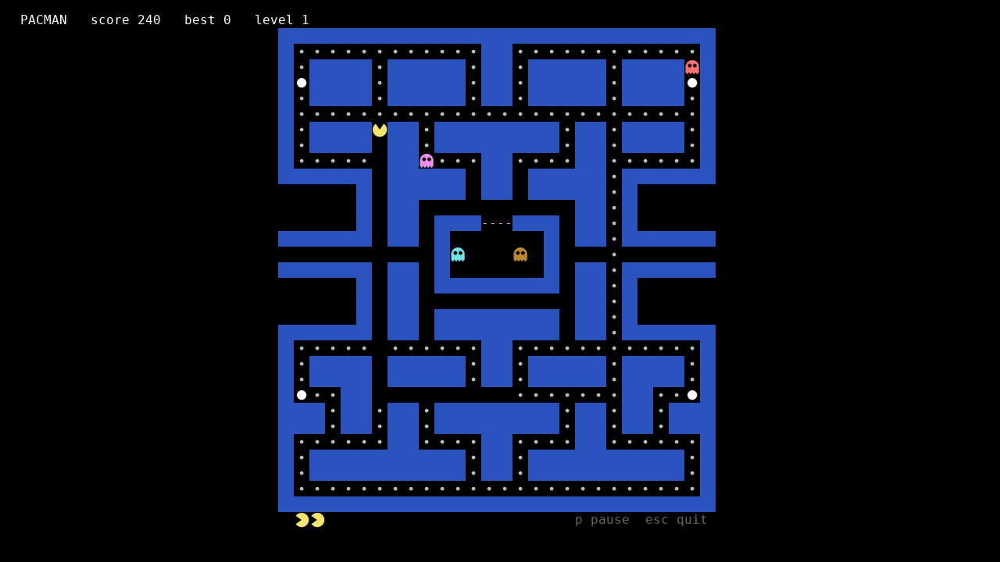

serpentis360 is a kernel for the xbox 360 that i wrote from zero. it boots from a usb stick through xell and turns the console into a small computer with a usb keyboard, a disk, users with passwords, a shell, a vim style editor and pacman. its C with some powerpc asm. there is no linux in it, no libxenon and no borrowed libc, from the moment xell jumps into it every instruction that runs is in this repo

why

i started this about a year and a half ago with an old 360 that had xell on it and was doing nothing. three powerpc cores at 3.2 ghz and 512 mb of ram is a lot more computer than the boards people usually write hobby kernels for, but almost everything that runs on it is the dashboard, an emulator or a homebrew game sitting on top of libxenon. i wanted to know what the machine does when nothing else is running on it. so the first goal was one character on the serial port, then one pixel on the tv, and it kept going from there

it uses the same filesystem and the same passwd and shadow files as serpentis-os, my x86 system. that was on purpose. if the same disk format works on a big endian cpu with a completely different boot, then the format is really defined and not just whatever x86 happened to do

how the 360 gets to it

the console needs xell, the loader that runs on a reset glitch or jtag hacked 360. power it on with the eject button and xell looks for xenon.elf in the root of a fat32 usb stick. xell only takes 32 bit elf files so the makefile turns the kernel into elf32 with objcopy, the code inside is still 64 bit. xell jumps to it in hypervisor real mode with the mmu off and r3 pointing at a device tree. the other five hardware threads come in 0x60 bytes later and park themselves at low priority

real mode on this cpu has a catch. xell leaves the RMI bit set in LPCR, so every access in real mode goes around the cache. slow, but plain loads and stores reach the hardware. the uart, the smc, usb and the gpu registers sit at 0x200 00000000 and up, and an address with 0x8000000000000000 in front skips HRMOR. almost all of that hardware is little endian while the cpu is big endian, so the drivers swap bytes all the time

the screen. xell already set up a framebuffer on the xenos gpu. the kernel reads its address and size from the gpu registers and draws into it. the pixels are not stored in rows, they are in 32 by 32 tiles, the address math is in platform/xenon/xenon.c. a display thread pushes the lines that changed out of the cache every 20 ms. the font is DejaVu Sans Mono turned into grey levels by tools/mkfont.py, at 1280x720 that gives 128 by 36 characters you can read from the couch

time and threads. external interrupts are masked in the interrupt controller, only the decrementer comes in, 100 times a second, and it drives the scheduler. threads are round robin and only switch inside the trap handler. everything else is polled, which is fine for a keyboard and a stick

usb. xell leaves the ehci controllers owning the ports. the kernel halts them and hands the ports to the ohci controllers next to them, usb 1.1 is plenty for a keyboard and a stick. there is a hub driver, hot plug, hid boot protocol for keyboards and mice and bulk only storage with scsi for sticks. every device gets its own address and a kind from its interface class, so a keyboard a mouse and a stick on the same hub never get mixed up

power. the smc runs power, fans and leds. reboot and shutdown send it a 16 byte message through its fifo

memory. one pool of 4 KB pages from 16 MB up to where the framebuffer starts, freed pages go on a stack and get handed out first

the filesystem. a superblock at sector 2048, 1024 entries of 512 bytes with the full path, owner, mode, time and up to 32 extents, a sector bitmap and the data. its little endian on disk like on x86 so a disk moves between the two systems. fsck checks parents, paths, extents that overlap or leave the disk and the bitmap against the extents

first boot

no serpentis filesystem on any disk means first boot. the kernel lists the disks and partitions it found and asks where to live, an existing partition, a new partition in the free space at the end of a disk, or memory only. then it asks for a user name, a password and a root password, writes /etc/passwd and /etc/shadow (sha256 with a random salt) and unpacks its own source to /src/serpentis360. after that its the normal login on every boot and everything you saved is still there. format yes wipes it and you are back at the setup

be careful with the stick xell boots from. it has the fat32 partition with xenon.elf on it and if you pick that one in the setup it gets erased. pick the new partition at the end or use a second stick

the shell

the terminal is a live document. 512 lines of text and the cursor goes anywhere in it with the arrows and page up and down. fix a line from three commands ago and press enter and it runs, or run a line straight out of some output. the prompt part of a line is protected. ctrl up and down go through the history, tab completes commands and paths, pipes and > and >> work

there are about 100 commands. ls cd cp mv rm mkdir with -r -p -f and the usual flags, cat head tail grep sort uniq cut wc diff tr tee xargs and more text tools, find du df tree stat fsck, su passwd useradd id chmod chown, lsusb lsblk ps mem, reboot and shutdown. help lists everything

the editor

edit or vi. normal insert visual and visual line mode like vim, counts, operators with motions and text objects, undo and redo, dot repeat, search, :s and :%s, line numbers and highlighting for C and asm. if you dont know vim, ctrl s saves and ctrl q quits in any mode

the source on the machine

the build packs the whole tree into the kernel as a tar file. the setup writes it to /src/serpentis360 so the kernel can be read and edited on the machine it runs on. src lists what is inside and src unpack writes a fresh copy somewhere else

pacman

type pacman. the sprites are drawn into the font so they come out round. how the game works is in its own repo, https://github.com/serpentis-os/pacman

trying it

if you just want to run it, take xenon.elf from https://github.com/serpentis-os/serpentis360/releases/latest/download/xenon.elf and put it in the root of a fat32 stick, plug a usb keyboard into the 360 and power on with the eject button

building

you need a gcc for 64 bit powerpc. i use the xenon toolchain from free60, only the compiler and binutils, nothing from libxenon gets linked. then

    make PLATFORM=xenon

and build/xenon/xenon.elf is the kernel

there are two more targets for when the console is not around. PLATFORM=qemu is qemu powernv, a POWER8 machine with skiboot. its not a 360 but its 64 bit big endian hypervisor mode, close enough for the core. PLATFORM=mac is qemu mac99, a g5 with an ohci controller like the 360 one, thats where usb gets tested. on both the screen is just a buffer in ram so you talk to it over the serial port

    make PLATFORM=qemu
    qemu-system-ppc64 -M powernv8 -cpu power8 -m 1G -nographic -kernel build/qemu/kernel.elf

test.sh builds a selftest kernel, boots it on powernv and checks the scheduler, the allocator and the trap handler

what is missing

no network, no sound, no dvd drive and no driver for the internal hard drive yet. only one hardware thread does any work. no real clock, the date starts in 2026 and counts up from boot. there are no processes with their own address space, every command is code inside the kernel. the gpu is only used as a framebuffer

credits

the font is DejaVu Sans Mono, its license is in LICENSE.fonts. the register addresses and the tile layout i got from reading libxenon and the free60 wiki, the code here is my own
